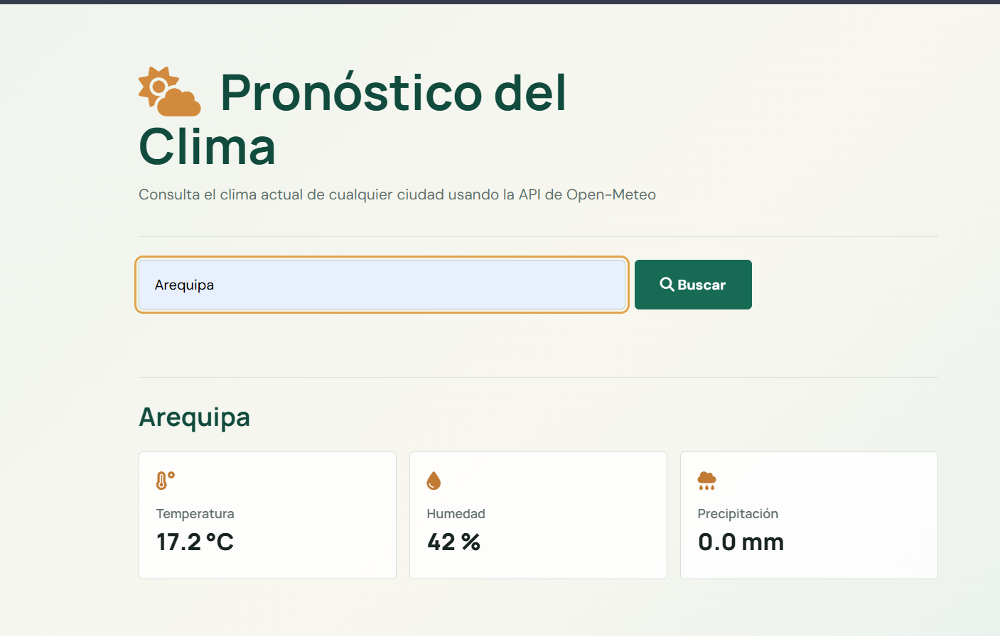

# LAB03_TAIS - Aplicación Web de Pronóstico del Clima

**Proyecto:** `weather-forecast-app`

Aplicación web de tipo **Single Page Application (SPA)**, desarrollada en TypeScript vanilla, que permite consultar las condiciones meteorológicas actuales de cualquier ciudad del mundo en tiempo real. No depende de frameworks pesados ni requiere un servidor backend propio.

## 📸 Vista previa



## 📌 Características principales

- **Consulta en tiempo real:** integración directa y gratuita con las API REST de Open-Meteo para geocodificación y pronóstico meteorológico.
- **Arquitectura modular por capas:** organización en presentación, controlador (patrón Mediador), servicios de negocio y clientes HTTP.
- **Resiliencia y control de errores:**
  - Tiempo de espera máximo de 10 segundos mediante `AbortController`.
  - Manejo de errores de conexión, respuestas HTTP con estados no exitosos y respuestas JSON malformadas.
  - Identificación explícita de ciudades no encontradas mediante `CITY_NOT_FOUND`.
- **Validación de entradas:**
  - Rechazo inmediato de entradas vacías o compuestas únicamente por espacios en blanco.
  - Limpieza de espacios con `trim()`.
  - Límite de 100 caracteres mediante `maxlength="100"`.
- **Formateo de métricas:** presentación normalizada de temperatura (°C), humedad (%) y precipitación (mm).

## 🛠️ Tecnologías utilizadas

- **Lenguaje:** TypeScript en modo estricto.
- **Pruebas:** Vitest, jsdom, `@testing-library/dom` y `fast-check` para pruebas basadas en propiedades.
- **API externas:**
  - Open-Meteo Geocoding API.
  - Open-Meteo Forecast API.

## 📁 Estructura del proyecto

```text
SDD Project/
├── design.md                # Arquitectura, componentes y reglas de diseño
├── requirements.md           # Historias de usuario y criterios de aceptación
├── tasks.md                  # Plan de trabajo y lista de tareas
├── index.html                # Punto de entrada HTML
├── package.json               # Dependencias y scripts
├── tsconfig.json              # Configuración de TypeScript
└── src/
    ├── main.ts                # Inicialización de la aplicación
    ├── WeatherController.ts   # Controlador principal (patrón Mediador)
    ├── clients/               # Clientes HTTP y control de peticiones
    ├── components/            # Componentes del DOM: formulario, clima y errores
    ├── services/              # Lógica de negocio y procesamiento de datos
    ├── tests/                 # Pruebas automatizadas
    ├── types/                 # Interfaces y tipos de TypeScript
    └── utils/                  # Formateadores y utilidades de limpieza de texto
```

## 🚀 Instalación y ejecución local

### 1. Clonar el repositorio

```bash
git clone https://github.com/klismannSis/LAB03_TAIS.git
cd LAB03_TAIS
```

### 2. Entrar a la carpeta del proyecto e instalar dependencias

```bash
cd "SDD Project"
npm install
```

### 3. Ejecutar en modo desarrollo

```bash
npm run dev
```

### 4. Compilar para producción

```bash
npm run build
```

## 🧪 Pruebas automatizadas

Según los resultados registrados para el proyecto, la suite de pruebas aprobó los **23 casos obligatorios** ejecutados con Vitest.

Para ejecutar las pruebas:

```bash
npm test
```

## 📋 Matriz de casos de prueba por módulo

### 1. Clientes HTTP y servicios de negocio

Archivo: `src/tests/clients-services.test.ts`

| Prueba | Entrada | Salida esperada | Estado |
|---|---|---|---|
| Geocodificación válida | `geocode('Lima')` | Objeto `Coordinates` con latitud, longitud y `cityName: 'Lima'` | PASS ✅ |
| Ciudad inexistente | `geocode('CiudadFantasma999')` | Error discriminado `CITY_NOT_FOUND` | PASS ✅ |
| Consulta del pronóstico | `getForecast(-12.04, -77.03)` | Objeto `WeatherData` con temperatura, humedad y precipitación | PASS ✅ |

### 2. Utilidades de formateo numérico

Archivo: `src/tests/formatters.test.ts`

| Prueba | Entrada | Salida esperada | Estado |
|---|---|---|---|
| Temperatura decimal | `formatTemperature(21.456)` | `21.5 °C` (un decimal) | PASS ✅ |
| Humedad decimal | `formatHumidity(72.8)` | `73 %` (entero redondeado) | PASS ✅ |
| Precipitación decimal | `formatPrecipitation(0.04)` | `0.0 mm` (un decimal) | PASS ✅ |

### 3. Componentes de interfaz y controlador

Archivo: `src/tests/ui-controller.test.ts`

| Prueba | Entrada | Salida esperada | Estado |
|---|---|---|---|
| Renderizado inicial del formulario | Crear `CitySearchForm` | Campo accesible con `maxlength="100"` y botón de envío activo | PASS ✅ |
| Envío mediante clic | Clic en **Buscar** con `Lima` | Invocación de `onSearch('Lima')` | PASS ✅ |
| Envío mediante Enter | Presionar Enter en el campo | Invocación de `onSearch('Lima')` | PASS ✅ |
| Entrada vacía | `''` | Mensaje: `El nombre de la ciudad es obligatorio.` | PASS ✅ |
| Solo espacios | `'   '` | Mensaje: `El nombre de la ciudad es obligatorio.` | PASS ✅ |
| Limpieza de espacios | `'  Arequipa  '` | Búsqueda con el nombre `Arequipa` | PASS ✅ |
| Renderizado del clima | `WeatherDisplay.render(data)` | DOM con ciudad, temperatura, humedad y precipitación | PASS ✅ |
| Limpieza del panel | `WeatherDisplay.clear()` | Sección del clima vacía | PASS ✅ |
| Indicador de carga | `LoadingIndicator.show()` | Indicador visible en el DOM | PASS ✅ |
| Mensaje de error | `ErrorMessage.render('Error')` | Mensaje de error visible en la interfaz | PASS ✅ |
| Inicialización del controlador | `new WeatherController()` | Estado inicial `idle` y componentes limpios | PASS ✅ |

### 4. Pruebas de extremo a extremo (E2E)

Archivo: `src/tests/app.e2e.test.ts`

| Prueba | Entrada o condición | Salida esperada | Estado |
|---|---|---|---|
| Flujo exitoso | Buscar `Arequipa` | Geocodificación, consulta del pronóstico y renderizado en el DOM | PASS ✅ |
| Ciudad inexistente | Buscar `Xyz999` | Mensaje: `No se encontró la ciudad ingresada.` | PASS ✅ |
| Error de red en geocodificación | Fallo de conexión | Mensaje: `El servicio de geocodificación no está disponible.` | PASS ✅ |
| Error de red en el pronóstico | Fallo de la Forecast API | Mensaje: `El servicio de pronóstico no está disponible.` | PASS ✅ |
| Timeout de geocodificación | Respuesta superior a 10 segundos | Cancelación mediante `AbortController` y mensaje de timeout | PASS ✅ |
| Timeout del pronóstico | Respuesta superior a 10 segundos | Cancelación mediante `AbortController` y mensaje de timeout | PASS ✅ |

## 👤 Autor

**Klismann Chancuaña Alvis**  
Universidad Nacional de San Agustín de Arequipa
